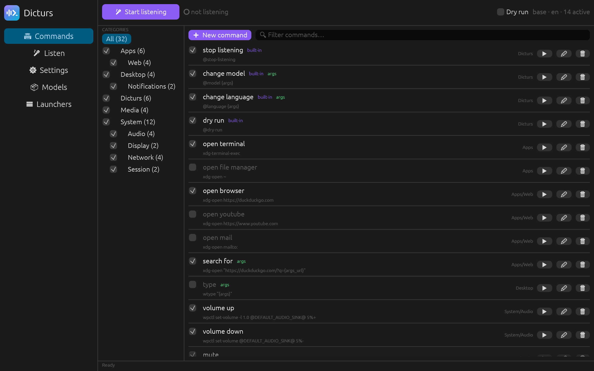
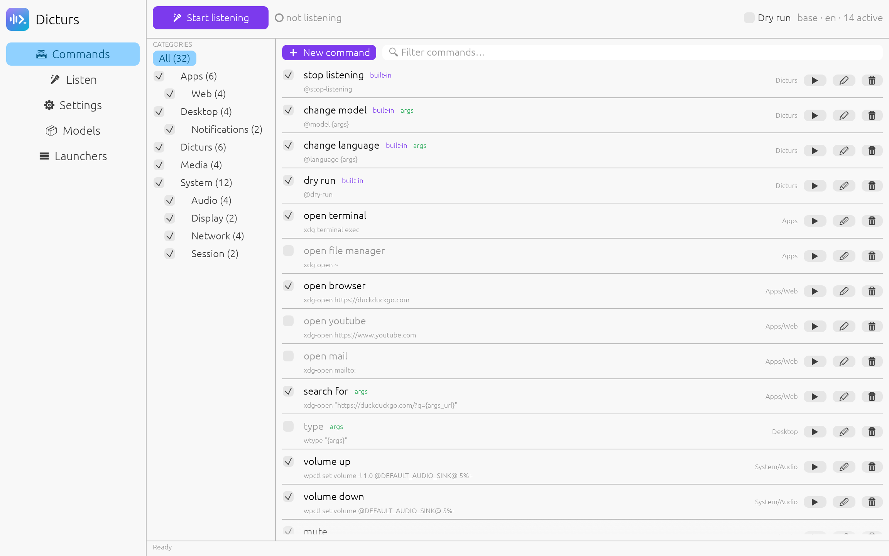
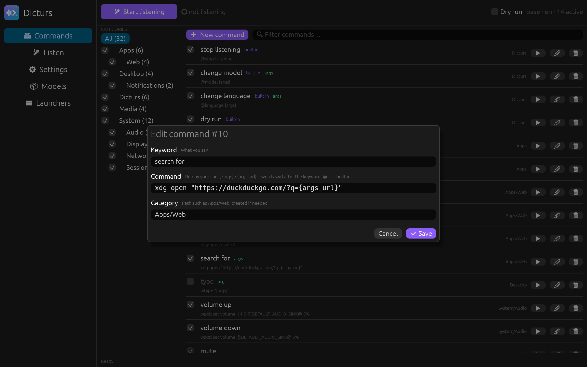
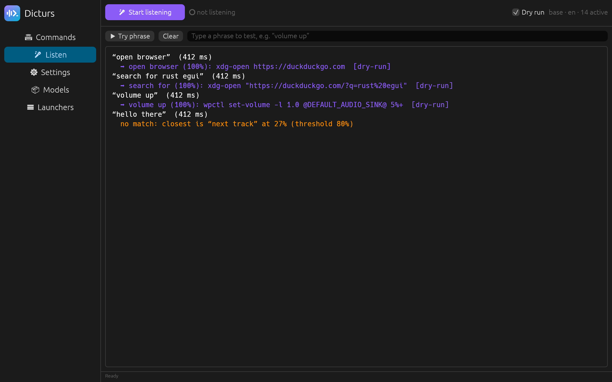
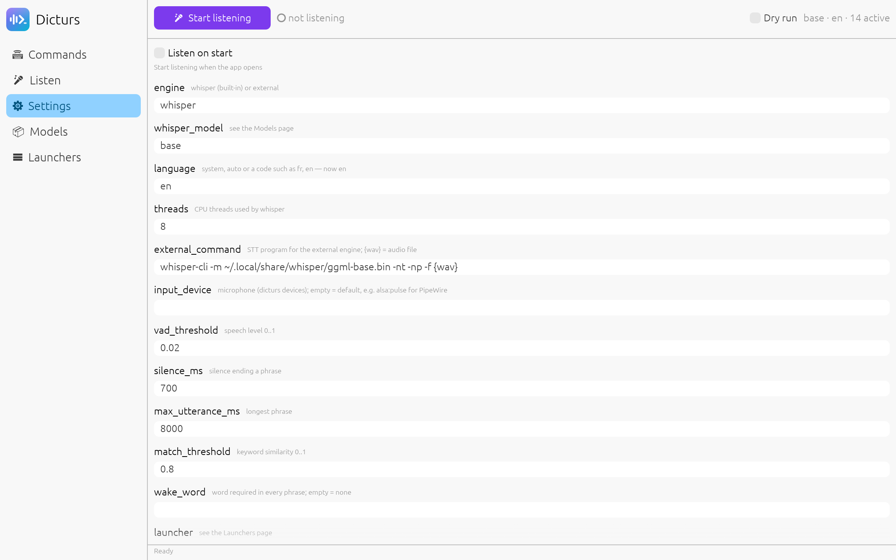
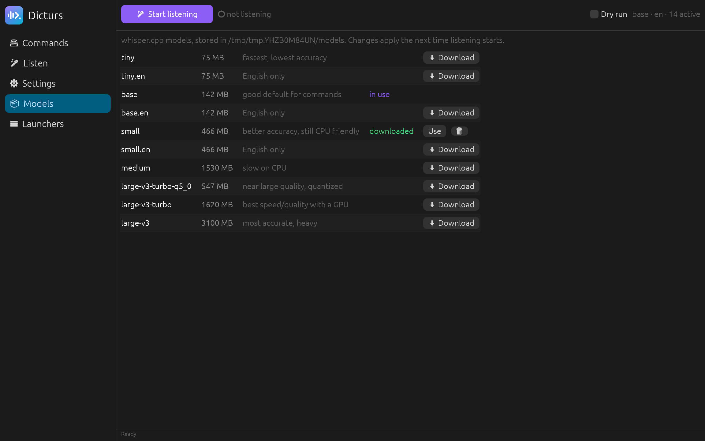
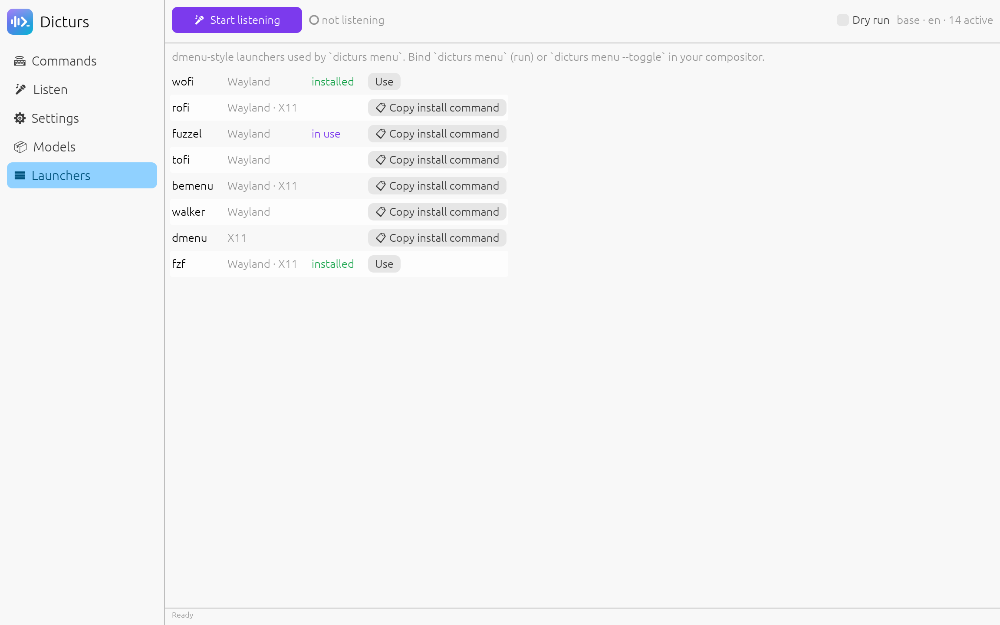

<p align="center">
  
</p>

<h1 align="center">Dicturs</h1>

<p align="center"><b>Say it. It runs.</b></p>

Run shell commands with your voice, offline. Written in Rust: offline speech recognition
(whisper.cpp), dmenu-style launcher integration (wofi, rofi, fuzzel, tofi, bemenu, walker, dmenu, fzf).

Three separate binaries, all on the same config:

| Binary | Feature | What |
|---|---|---|
| `dicturs` | `cli` | command line (`dicturs` alone runs `dicturs-tui`, `dicturs gui` runs `dicturs-gui`) |
| `dicturs-tui` | `tui` | terminal UI (ratatui, mouse support) |
| `dicturs-gui` | `gui` | desktop UI (egui, OpenGL), follows the system dark/light mode |

## Screenshots



| | | |
|---|---|---|
| [](docs/screenshots/02-commands-light.png) | [](docs/screenshots/03-editor.png) | [](docs/screenshots/04-listen.png) |
| Light mode | Command editor | Listening log |
| [](docs/screenshots/05-settings.png) | [](docs/screenshots/06-models.png) | [](docs/screenshots/07-launchers.png) |
| Settings | Speech models | Launchers |

## Install

Linux and macOS (x86_64, arm64), from the latest release:

```sh
curl -fsSL https://dicturs.app/install.sh | sh                          # all three
curl -fsSL https://dicturs.app/install.sh | sh -s -- --bins cli,tui     # pick binaries
sh install.sh --uninstall                                                              # remove
```

The script ([`install.sh`](install.sh)) installs into `~/.local/bin` (`--dir` to change) and checks
the SHA-256 of the archive. Windows (x86_64, arm64): download the `.zip` from the releases page.

From source:

```sh
cargo install --path .              # all three; needs cmake + a C++ compiler (builds whisper.cpp)
dicturs model use base              # download + select a whisper model
dicturs-tui                         # or dicturs-gui
```

Pick the binaries at build time with features (`whisper` = built-in engine):

```sh
cargo install --path . --no-default-features --features whisper,cli        # CLI only
cargo install --path . --no-default-features --features whisper,cli,tui    # CLI + TUI
cargo install --path . --no-default-features --features cli                # external engine only
```

Each binary only contains its own UI: `dicturs` links neither ratatui nor egui.

## Concepts

- **Command**: `keyword => shell command`, with a category and an enabled flag (toggle, don't delete).
- **Categories**: paths such as `Apps/Web`. Disabling a category disables all its subcategories and
  commands (shown as `◌`).
- **Matching**: accent/punctuation-insensitive, fuzzy (`match_threshold`). The longest matching keyword wins.
  Optional `wake_word` ("jarvis volume up").
- **Shell**: commands run through `shell` (`auto` = `$SHELL`) so your aliases work: `bash`/`zsh` run
  interactive, `nu` gets `config.nu`, `env.nu` and every `autoload/*.nu` file.
- **Language**: `system` (default) reads `LC_ALL`/`LC_MESSAGES`/`LANG`, `auto` lets whisper detect it,
  or set a code (`fr`, `en`, ...).

## Arguments and built-in commands

- `{args}` in a command is replaced by the words said **after** the keyword, `{args_url}` by the
  same words URL-encoded. Only letters, digits and spaces are kept, so speech cannot inject shell
  syntax. Example: keyword `search for`, command `xdg-open "https://duckduckgo.com/?q={args_url}"`,
  then say "search for rust ratatui".
- Commands starting with `@` are handled by dicturs itself (enabled by default, editable like any command):

| Keyword (en / fr) | Command | Effect |
|---|---|---|
| stop listening / arrête d'écouter | `@stop-listening` | stops listening (`dicturs listen` exits) |
| change model / change de modèle | `@model {args}` | "change model small", "… turbo" (must be downloaded) |
| change language / change de langue | `@language {args}` | "change language french", "… system" |
| dry run / mode test | `@dry-run` | toggles dry-run |

Model/language changes restart listening. Built-ins also run in dry-run mode.

## CLI

```sh
dicturs add "ouvre le navigateur" "firefox" -c Apps/Web
dicturs list [-c Apps] [--active] [--json]
dicturs toggle 3 4 | dicturs enable 3 | dicturs disable 3 | dicturs edit 3 -k "browser" | dicturs rm 3
dicturs cat ls | dicturs cat add Media/Music | dicturs cat toggle Media | dicturs cat rename Media Multimedia
dicturs listen [--dry-run] [--once]       # headless listening (e.g. as a systemd user service)
dicturs say "volume up" [--dry-run]       # simulate a transcription
dicturs transcribe clip.wav [--dry-run]   # test the engine on a file (ffmpeg)
dicturs menu [--toggle] [--print] [-l rofi]
dicturs launcher ls | dicturs launcher install fuzzel | dicturs launcher use fuzzel
dicturs model ls | dicturs model download small | dicturs model use small
dicturs settings | dicturs settings set language system | dicturs settings set shell nu
dicturs devices
dicturs init [--lang en|fr|system] [--no-samples]   # first launch: create the config
dicturs seed [--lang en|fr|system] [--list]         # add the samples you don't have (disabled)
```

## Launcher integration

Bind in your compositor, e.g. Hyprland:

```
bind = SUPER, V, exec, dicturs menu
bind = SUPER SHIFT, V, exec, dicturs menu --toggle
```

`launcher` accepts a known name or any dmenu-compatible command (`{prompt}` is substituted).

## Engines

- `whisper` (default): built-in whisper.cpp; the keywords are passed as initial prompt to bias recognition.
- `external`: any program printing a transcription; `{wav}` = 16 kHz mono WAV, e.g.
  `whisper-cli -m model.bin -nt -np -f {wav}` or a Vosk / faster-whisper script.

Sample commands are seeded in English, disabled. On first launch the TUI and GUI ask for their
language (English, Français, system language or none); from the CLI use `dicturs init --lang`.

Config: `~/.config/dicturs/config.toml` (`DICTURS_CONFIG_DIR` overrides).
Models: `~/.local/share/dicturs/models` (`DICTURS_MODELS_DIR` overrides).
Folders from the former name (`voice-commander`) are moved there automatically on first run.

## Development

- `www/`: the website (Vike, React, Motion, i18next, daisyUI): `cd www && npm install && npm run dev`.
- Releases use git-flow (AVH) and two scripts. One-time setup:

  ```sh
  git flow init -d
  git config gitflow.prefix.versiontag v       # tags are v0.1.0, v0.2.0…
  git config gitflow.path.hooks scripts/hooks  # bump the version on release/hotfix start
  ```

  Then for each release (or `git flow hotfix start/finish` for a fix):

  ```sh
  git flow release start 0.2.0    # runs scripts/bump-version.sh: asks for a description, updates
                                  # VERSION, Cargo.toml, Cargo.lock and CHANGELOG.md, commits
  git flow release finish 0.2.0
  scripts/release.sh              # pushes branches + tags, creates the GitHub release (CHANGELOG notes)
  ```

  Publishing the release starts `.github/workflows/release.yml`, which builds Linux (x86_64, arm64),
  macOS (arm64, x86_64) and Windows (x86_64, arm64) archives and attaches them, with `install.sh`.
  `scripts/bump-version.sh --help` lists the options (`major|minor|patch`, `-m`, `--screenshots`).
- Website: `.github/workflows/pages.yml` publishes `www/` and `install.sh` on GitHub Pages
  (Settings › Pages › Source: GitHub Actions).
- Screenshots: `scripts/screenshots.sh` runs a debug build of `dicturs-gui` with
  `DICTURS_SCREENSHOTS=<dir>` on a demo config (yours is never shown) and refreshes
  `docs/screenshots/`, used here and on the website. The tour does not exist in release builds.
- Logo: [`assets/logo.svg`](assets/logo.svg), also embedded in `dicturs-gui` (sidebar and window icon) and copied into the site.
